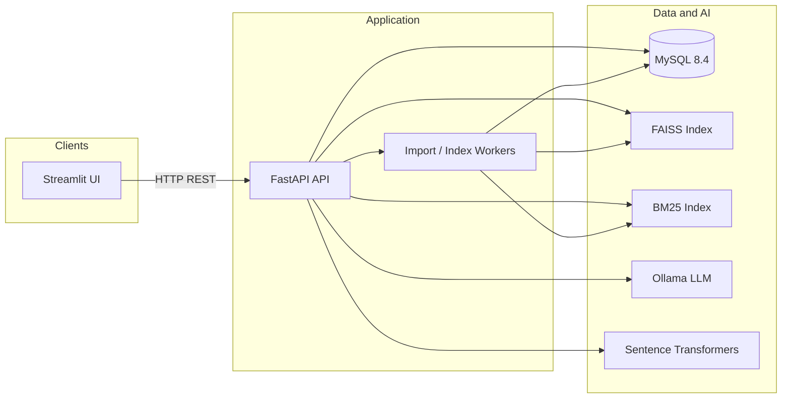
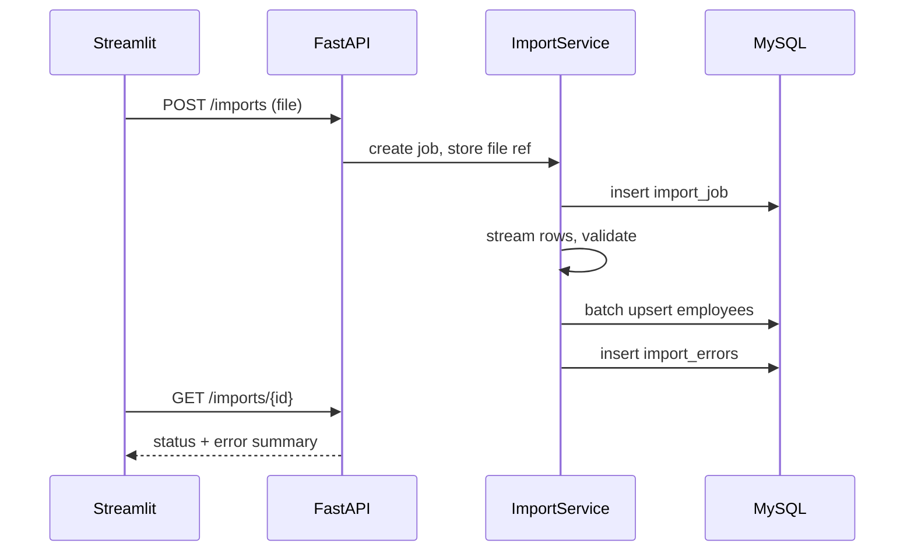
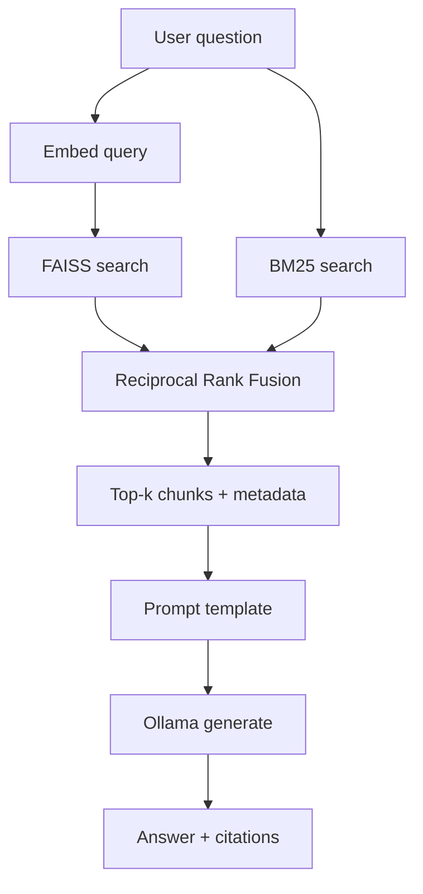

# SmartHRIS-AI — Architecture

## High-level system context



**Principle**: Streamlit is a thin client. All business rules, validation, and persistence live in FastAPI services.

## Layered backend design

```
HTTP (routers)
    → Dependencies (auth, db session)
        → Services (use cases)
            → Repositories (SQLAlchemy queries)
                → Models (ORM)
```

| Layer | Responsibility |
|-------|----------------|
| `api/routers` | HTTP mapping, status codes, request/response schemas |
| `api/deps` | DB session, current user, settings |
| `services` | Transactions, orchestration, domain validation |
| `repositories` | Query composition; no HTTP knowledge |
| `models` | SQLAlchemy 2.0 declarative models |
| `schemas` | Pydantic DTOs separate from ORM models |

## Proposed repository layout

```
SmartHRIS-AI/
├── docker/                 # Dockerfiles and compose overrides
├── docs/                   # Requirements, architecture, roadmap (this folder)
├── scripts/                # One-off maintenance, seed data, local helpers
├── src/
│   └── smarthris/
│       ├── __init__.py
│       ├── main.py           # FastAPI app factory
│       ├── config.py         # pydantic-settings
│       ├── api/
│       │   ├── routers/      # employees, upload, salary, lms, rag, health
│       │   └── deps.py
│       ├── core/             # security, logging, exceptions
│       ├── db/
│       │   ├── session.py
│       │   └── base.py
│       ├── models/           # SQLAlchemy entities
│       ├── schemas/          # Pydantic models
│       ├── services/         # business logic
│       ├── repositories/     # data access
│       └── rag/
│           ├── chunking.py
│           ├── embeddings.py
│           ├── faiss_store.py
│           ├── bm25_store.py
│           ├── fusion.py
│           └── pipeline.py
├── streamlit_app/
│   ├── app.py                # entrypoint
│   ├── pages/                # multi-page Streamlit
│   └── api_client.py         # httpx wrapper for FastAPI
├── tests/
│   ├── unit/
│   ├── integration/
│   └── conftest.py
├── alembic/                  # migrations
├── data/                     # sample CSV, policy docs (gitignored if large)
├── .env.example
├── pyproject.toml            # or requirements.txt + requirements-dev.txt
├── docker-compose.yml
└── README.md
```

### Folder purposes (summary)

| Path | Purpose |
|------|---------|
| `docker/` | Reproducible images for API, Streamlit; optional Ollama sidecar config |
| `docs/` | Human-readable specs and decisions |
| `scripts/` | DB seed, reindex, benchmark import— not imported by runtime |
| `src/smarthris/` | Installable Python package for the API and shared libs |
| `streamlit_app/` | UI only; calls API |
| `tests/` | pytest layout mirroring services |
| `alembic/` | Schema evolution |
| `data/` | Local fixtures; large files in `.gitignore` |

## Database domain (logical model)

Core entities (tables will gain indexes and FKs during implementation):

- `departments`, `job_titles` (lookup)
- `employees` (master)
- `salary_records` (history, FK employee)
- `courses`, `enrollments`, `certifications`
- `import_jobs`, `import_errors` (bulk upload audit)
- `documents`, `document_chunks` (RAG source metadata; vectors may live on disk)

**Bulk import**: persist job status (`pending`, `running`, `completed`, `failed`) and row errors for UI polling.

## Bulk upload pipeline



Design notes:

- Use **batched commits** (e.g. 500–2000 rows) to balance memory and transaction size
- Validate with Pydantic row models before insert
- Consider `LOAD DATA` only as an optimization phase—not first milestone

## LMS flows

- Admin creates course → assigns enrollment to employee or bulk by department
- Employee progresses via API updates (Streamlit forms)
- On completion: create `certification` row with unique `certificate_code`

## Hybrid RAG pipeline



| Component | Role |
|-----------|------|
| Chunking | Fixed token/char windows with overlap; store `source`, `page`, `doc_id` |
| Embeddings | Sentence Transformers; cache model singleton |
| FAISS | `IndexFlatIP` or `IndexHNSW` after normalization; save under `data/indexes/` |
| BM25 | `rank_bm25` or similar over in-memory tokenized corpus loaded from DB/disk |
| RRF | Merge ranked lists without score normalization headaches |
| Ollama | HTTP API (`/api/generate` or chat); configurable base URL |

**Safety**: System prompt instructs model to cite chunk ids; if retrieval score is weak, return “I don’t have enough information.”

## Configuration

Use `pydantic-settings` with `.env`:

- `DATABASE_URL` (async: `mysql+aiomysql://` or sync `mysql+pymysql://`—pick one style early)
- `OLLAMA_BASE_URL`, `OLLAMA_MODEL`
- `EMBEDDING_MODEL_NAME`
- `FAISS_INDEX_PATH`, `SECRET_KEY`, `API_PREFIX`

Provide `.env.example` only; never commit secrets.

## Docker Compose (target)

| Service | Image / build | Notes |
|---------|---------------|--------|
| `mysql` | `mysql:8.4` | volume for data, init scripts optional |
| `api` | build `docker/Dockerfile.api` | waits for MySQL healthcheck |
| `streamlit` | build `docker/Dockerfile.streamlit` | `API_BASE_URL` env |
| `ollama` | `ollama/ollama` | optional profile; pull model in docs |

On Windows dev, you may run MySQL natively (service **MySQL84**) and only containerize API later.

## Cross-cutting concerns

- **Logging**: `structlog` or standard `logging` JSON in API
- **Errors**: unified exception handlers → consistent JSON error body
- **Migrations**: Alembic autogenerate after first models
- **Testing**: Testcontainers or dedicated `smarthris_test` schema; factory fixtures for employees

## Security (incremental)

1. Health + open read-only demo (dev only)
2. JWT + bcrypt passwords
3. Rate limit on upload and RAG endpoints (later)

## PHP → Python mental map

| PHP habit | Python/FastAPI equivalent |
|-----------|---------------------------|
| Laravel routes | FastAPI `APIRouter` |
| Eloquent | SQLAlchemy 2.0 + repositories |
| DTOs / Form requests | Pydantic `schemas` |
| `.env` + config | `pydantic-settings` |
| Composer autoload | `src` package + `pyproject.toml` |
| PHPUnit | pytest + fixtures |

## Risks and mitigations

| Risk | Mitigation |
|------|------------|
| 100k row import OOM | Stream rows; batch DB writes; job status API |
| FAISS + Windows paths | Use pathlib; document index rebuild |
| Ollama not on PATH | Docker service or install docs; health check endpoint |
| Streamlit + API duplication | Single API client module |
